# Hardware Inventory and Assessment Report

## 1. Assessment Information

| Parameter | Details |
|---|---|
| Project | Hardware Support and Troubleshooting Lab |
| Assessment Date | 26 November 2026 |
| Device Type | Laptop |
| Assessment Method | Physical system and software-based diagnostics |
| Operating System | Windows 11 Pro |

## 2. Computer Identification

| Component | Specification |
|---|---|
| Manufacturer | Lenovo |
| Product Family | Legion Y7000 2021 |
| System Model | 82JK |
| System Architecture | x64 |
| Platform Role | Mobile |

### Evidence

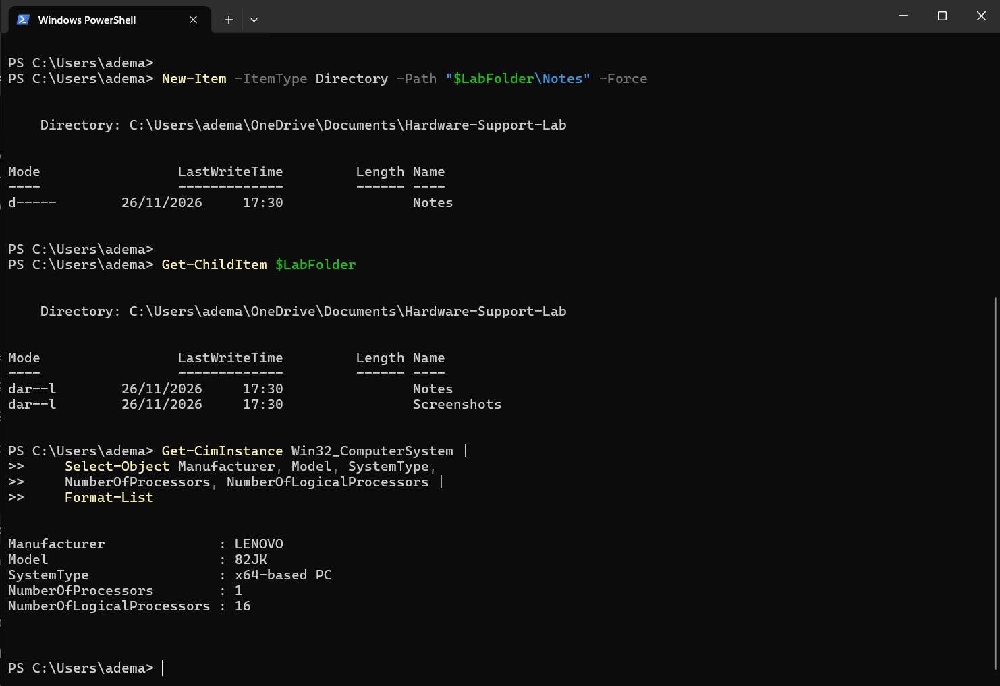

## 3. Processor

| Component | Specification |
|---|---|
| Manufacturer | Intel |
| Processor | Core i7-11800H |
| Generation | 11th Generation |
| Physical Processors | 1 |
| Physical Cores | 8 |
| Logical Processors | 16 |
| Base Clock Speed | 2.30 GHz |
| Architecture | 64-bit |

### Evidence

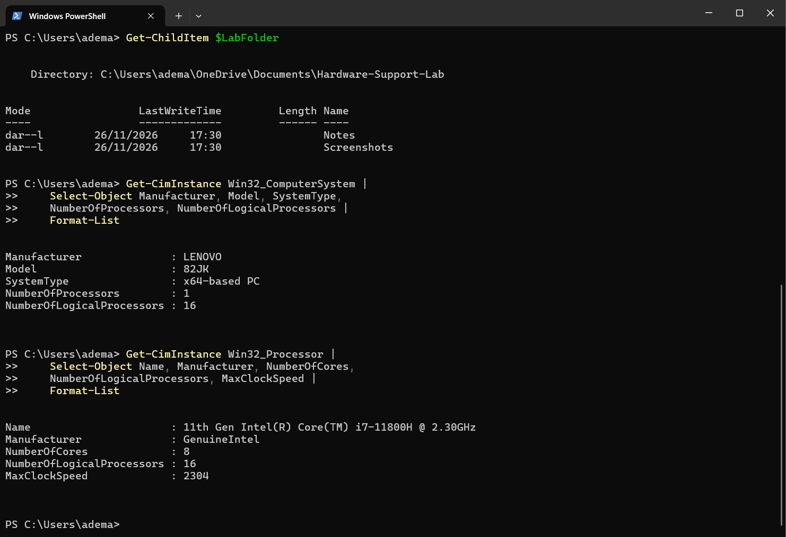

## 4. Motherboard

| Component | Specification |
|---|---|
| Manufacturer | Lenovo |
| Product | LNVNB161216 |
| Version | SDK0T76479 WIN |

### Evidence

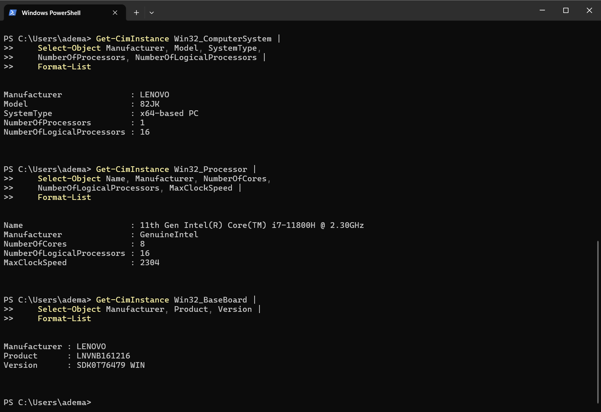

## 5. BIOS and Firmware

| Component | Specification |
|---|---|
| BIOS Manufacturer | Lenovo |
| BIOS Version | H1CN49WW |
| BIOS Release Date | 16 August 2022 |
| BIOS Mode | UEFI |
| SMBIOS Version | 3.3 |
| Embedded Controller Version | 1.49 |
| Secure Boot | Enabled |

### Evidence

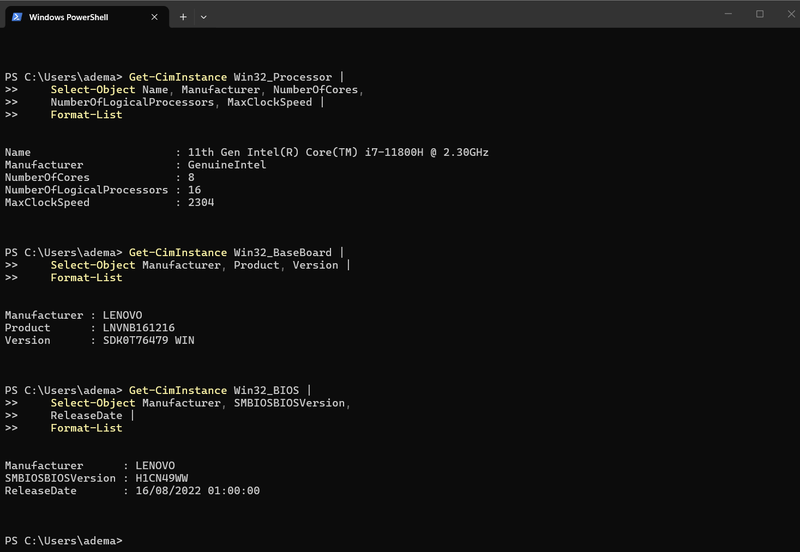

## 6. Graphics Hardware

| Component | Specification |
|---|---|
| Dedicated Graphics | NVIDIA GeForce RTX 3050 Laptop GPU |

### Evidence

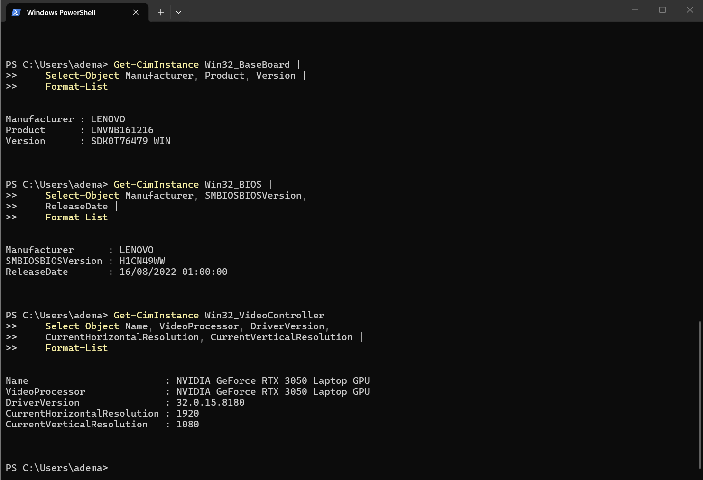

## 7. Physical Memory

| Component | Specification |
|---|---|
| Installed RAM | 32 GB |
| Diagnostic Tool | Windows Memory Diagnostic |
| Memory Errors Detected | None |
| Diagnostic Result | Passed |

### Evidence

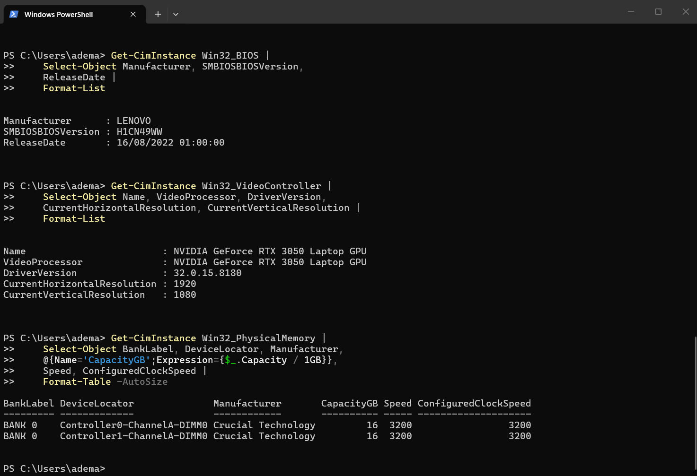

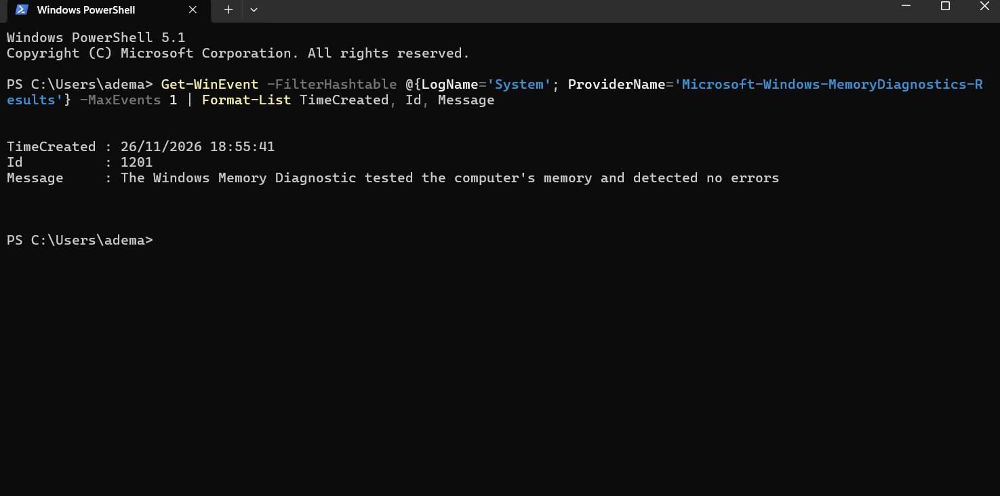

## 8. Storage Hardware

| Component | Specification |
|---|---|
| Drive Model | WD PC SN540 SDDPNPF-1T00 |
| Storage Type | SSD |
| Nominal Capacity | 1 TB |
| System Volume Capacity | 952.17 GiB |
| File System | NTFS |
| Available Space | 214.73 GiB |
| Available Percentage | 22.55% |
| Health Status | Healthy |
| Operational Status | OK |
| File System Errors | None detected |

### Evidence

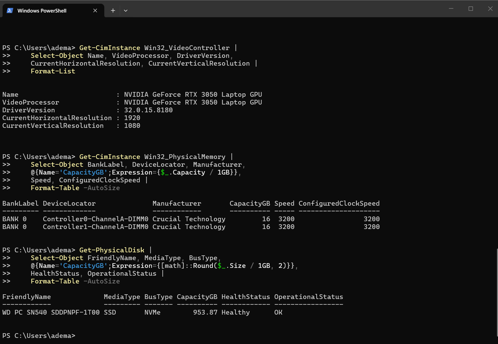

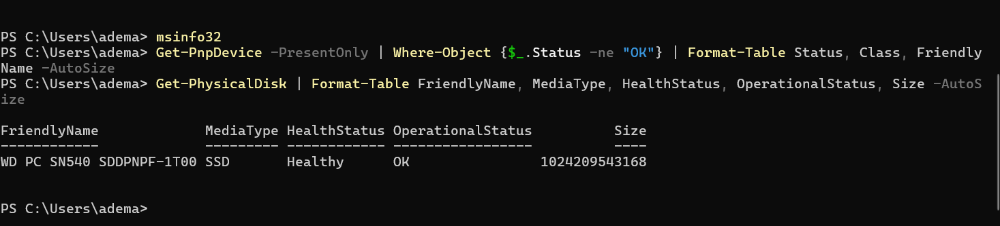

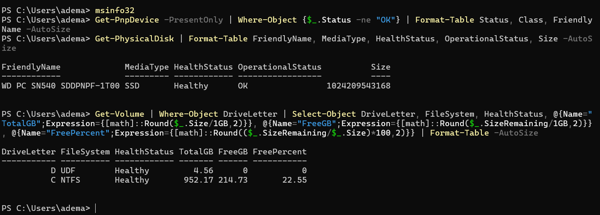

## 9. Battery

| Component | Specification |
|---|---|
| Manufacturer | Celxpert |
| Battery Model | L20C4PC1 |
| Chemistry | Lithium Polymer |
| Design Capacity | 80,000 mWh |
| Full Charge Capacity | 63,710 mWh |
| Charge Cycles | 755 |
| Battery Health | 79.64% |
| Capacity Degradation | 20.36% |

### Assessment

The battery exhibits measurable capacity degradation. Continued monitoring is recommended, with replacement considered if battery runtime becomes insufficient.

### Evidence

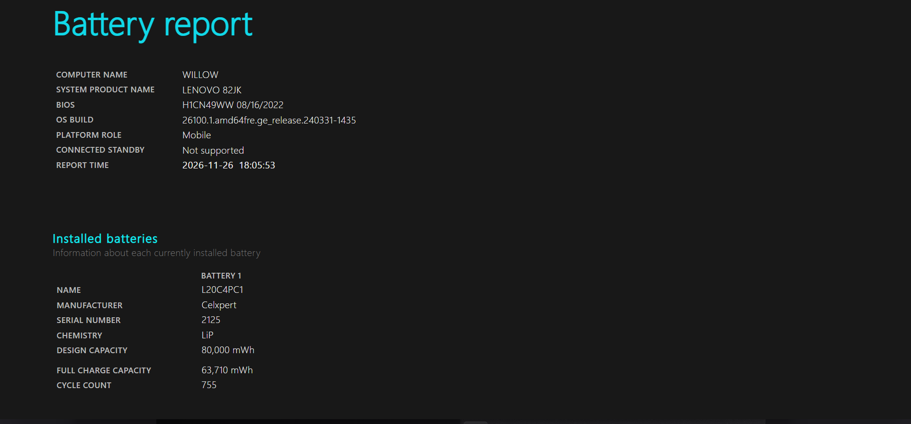

## 10. Peripheral and Device Assessment

Connected hardware and peripheral devices were inspected using PowerShell and Windows Device Manager.

No currently present Plug and Play devices returned a non-OK status during the PowerShell health check.

### Evidence

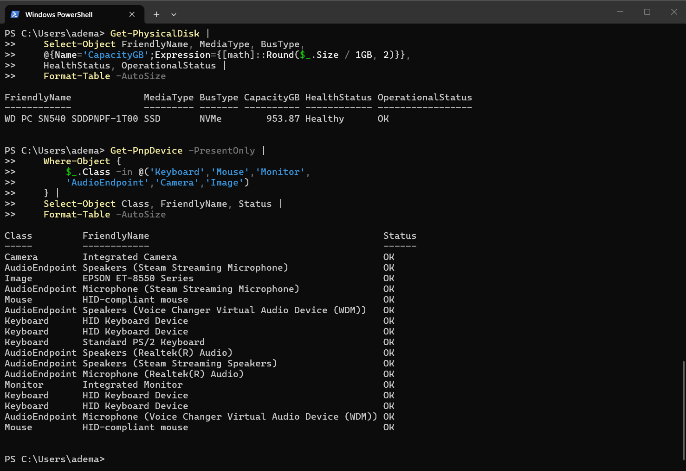

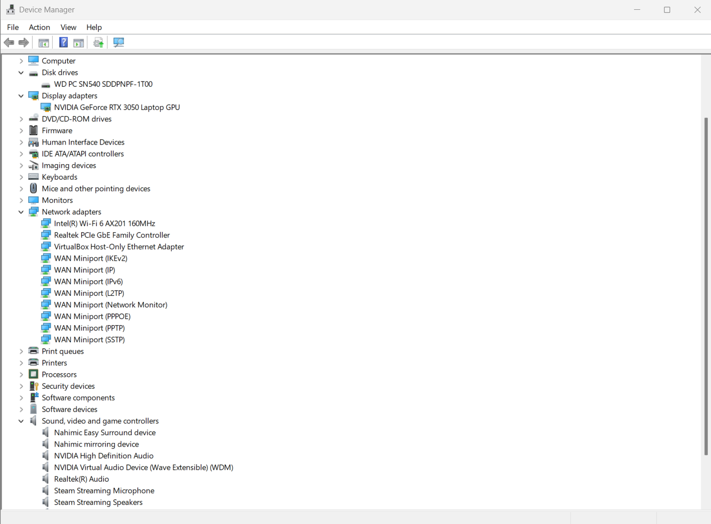

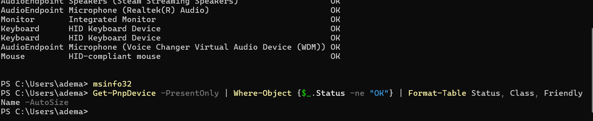

## 11. Overall Hardware Assessment

| Hardware Area | Assessment |
|---|---|
| Processor | Identified |
| Motherboard | Identified |
| BIOS and Firmware | Identified |
| Graphics Hardware | Identified |
| Physical Memory | Diagnostic passed |
| SSD | Healthy |
| Storage Capacity | Sufficient at assessment |
| Battery | Monitoring recommended |
| Plug and Play Devices | No non-OK status reported |
| System Stability | Unexpected shutdown investigated |

## 12. Recommendations

- Monitor battery capacity and runtime.
- Maintain sufficient available storage space.
- Review Windows and manufacturer driver updates periodically.
- Monitor for recurring Kernel-Power Event ID 41 incidents.
- Maintain regular backups.
- Repeat hardware diagnostics when performance or stability issues arise.

## Conclusion

The hardware inventory and diagnostic assessment established a baseline of the workstation's configuration and reported health.

No memory errors, file system corruption or physical disk health warnings were detected during the performed tests. Battery degradation and an unexpected shutdown event were identified as areas requiring continued monitoring.

This assessment demonstrates practical hardware identification, asset documentation, diagnostic interpretation and preventive maintenance skills.
