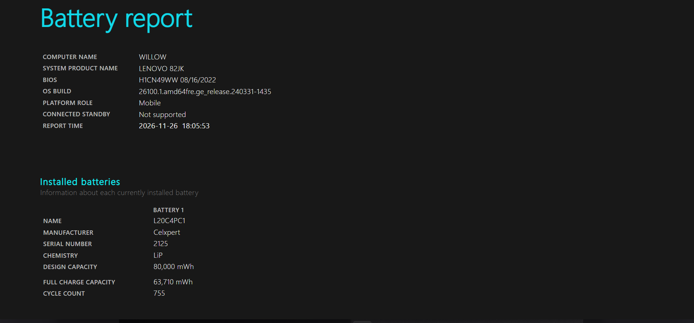
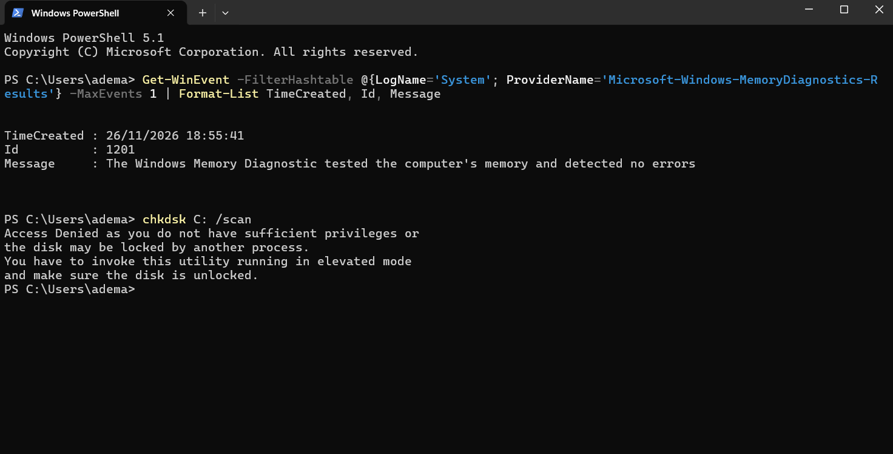
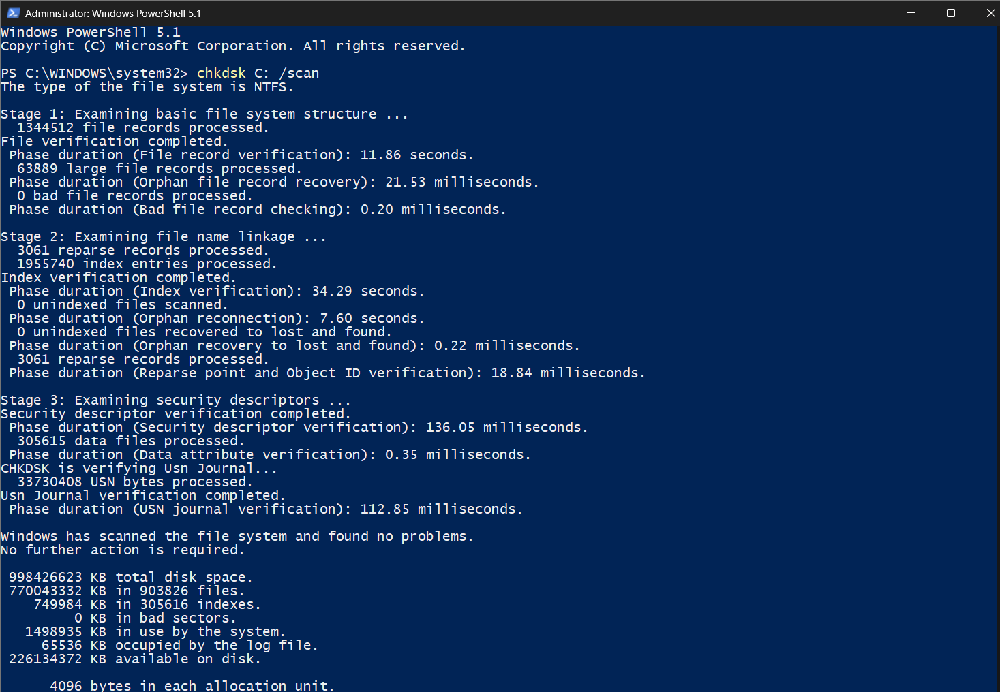
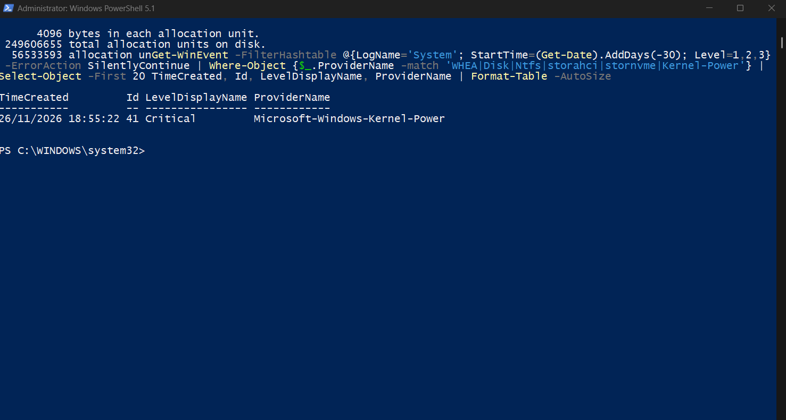
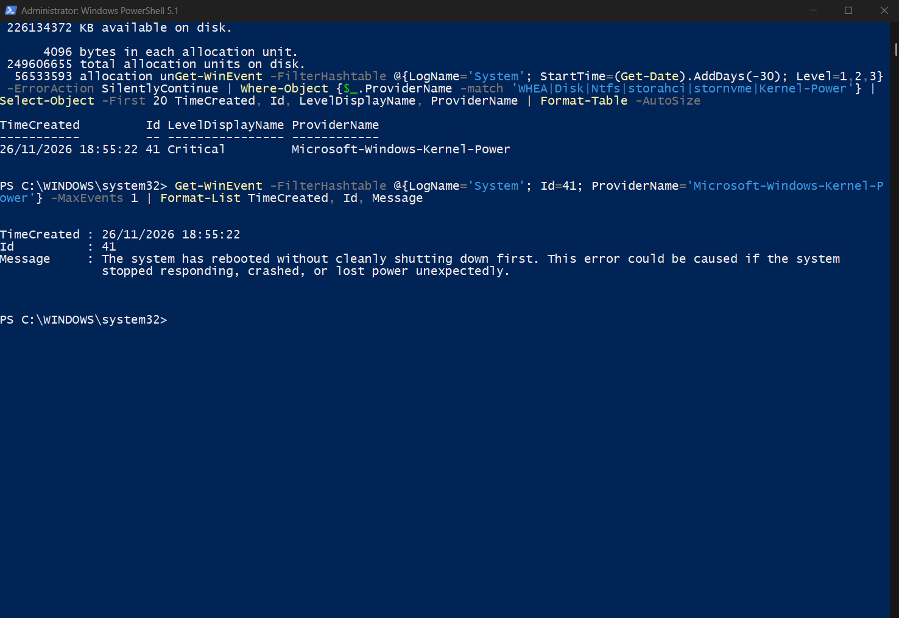
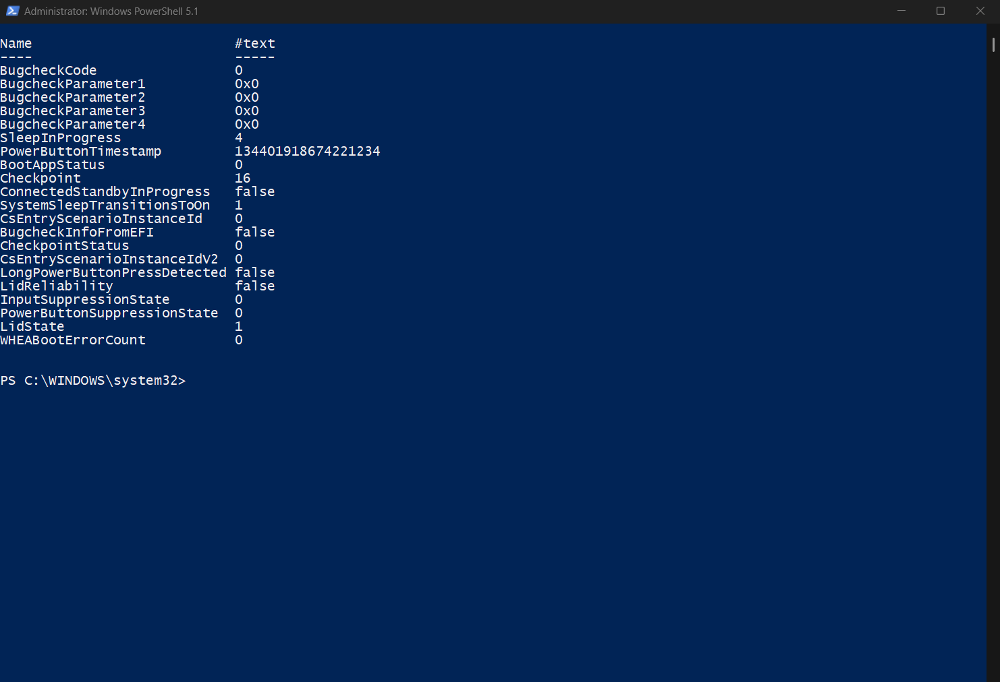
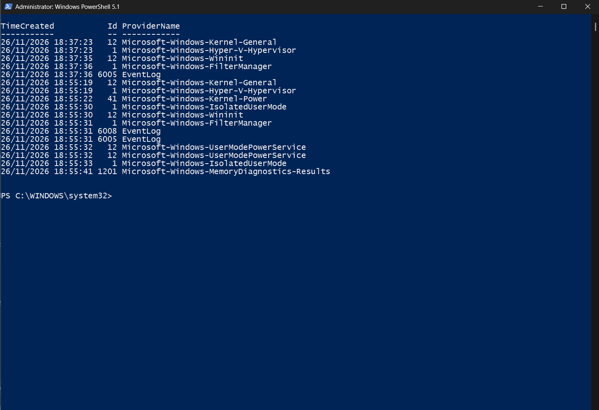
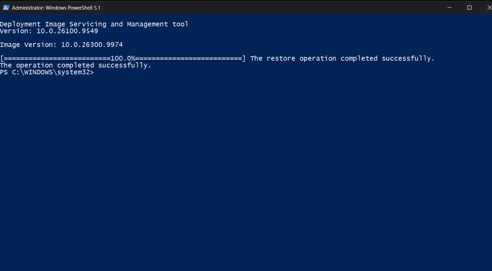
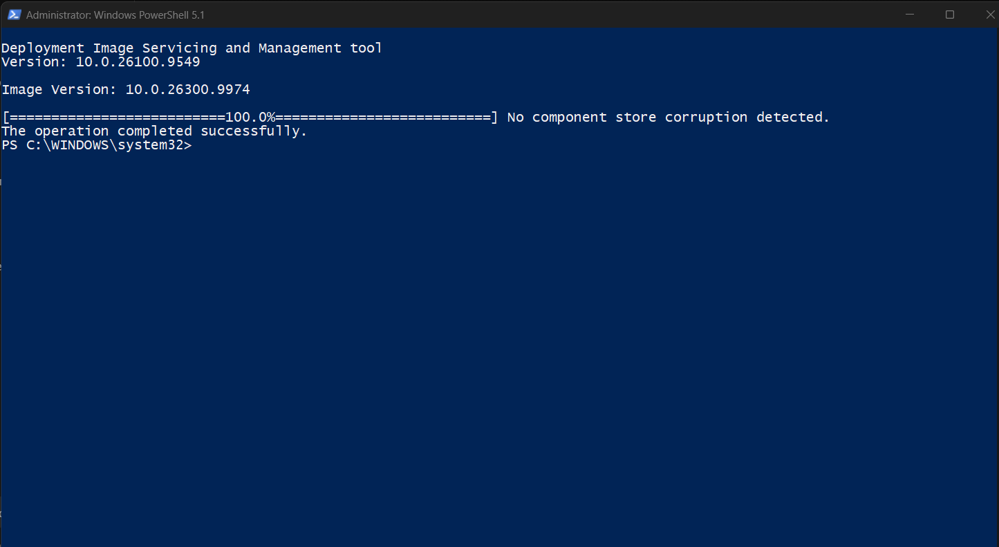
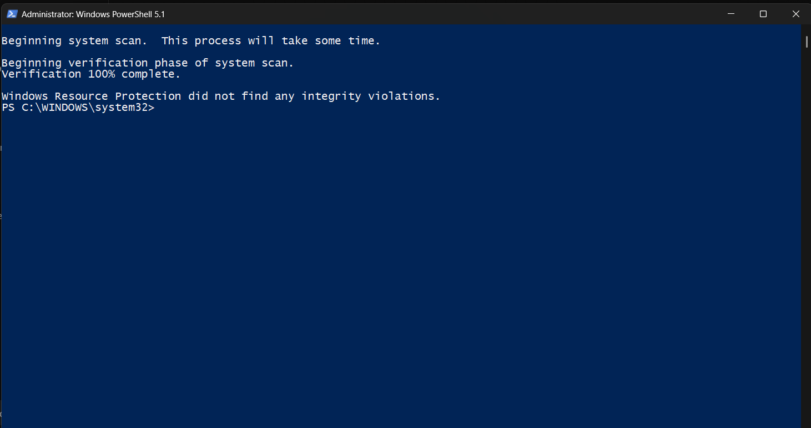

# Technical Troubleshooting Case Reports

## Project Information

- Project: Hardware Support and Troubleshooting Lab
- Environment: Windows 11 Pro
- Assessment Date: 26 November 2026
- Device: Lenovo Legion Y7000 2021
- Methodology: Identification, investigation, diagnosis, resolution and verification

---

## Incident 001: Battery Capacity Degradation

### Incident Details

- Category: Hardware
- Priority: Low
- Status: Monitoring recommended

### Problem Identification

A Windows battery health report identified a reduction in the battery's original charge capacity.

### Diagnostic Command

```powershell
powercfg /batteryreport
```

### Findings

| Parameter | Result |
|---|---|
| Design Capacity | 80,000 mWh |
| Full Charge Capacity | 63,710 mWh |
| Charge Cycles | 755 |
| Battery Health | 79.64% |
| Capacity Degradation | 20.36% |

### Probable Cause

Battery degradation associated with normal ageing and repeated charging cycles.

### Recommended Action

- Monitor battery performance.
- Avoid prolonged exposure to excessive temperatures.
- Consider battery replacement if runtime becomes insufficient.

### Evidence



---

## Incident 002: CHKDSK Access Denied

### Incident Details

- Category: Administrative Permissions
- Priority: Low
- Status: Resolved

### Problem Identification

The CHKDSK utility returned an Access Denied error when attempting to scan the system drive.

### Root Cause

The PowerShell session was running without elevated administrative privileges.

### Corrective Action

Launched an elevated PowerShell session using:

```powershell
Start-Process powershell -Verb RunAs
```

Repeated the original diagnostic command:

```powershell
chkdsk C: /scan
```

### Verification

- File system scan completed successfully.
- No file system corruption detected.
- Zero bad file records reported.
- Zero KB in bad sectors reported.
- No further corrective action required.

### Evidence

**Before resolution:**



**After resolution:**



---

## Incident 003: Kernel-Power Event ID 41

### Incident Details

- Category: System Stability and Power Management
- Priority: Medium
- Status: Investigated; monitoring recommended

### Problem Identification

Windows System Event Log analysis identified a critical Kernel-Power Event ID 41, indicating an unexpected or unclean shutdown.

### Investigation

The investigation included:

- Windows System Event Log filtering.
- Detailed examination of Event ID 41.
- XML event data analysis.
- Power-button timestamp examination.
- Bugcheck code analysis.
- Correlation of system startup and shutdown events.

### Findings

| Parameter | Result |
|---|---|
| Event ID | 41 |
| Severity | Critical |
| Bugcheck Code | 0 |
| Power Button Timestamp | Recorded |
| Long Power Button Press Detected | False |
| WHEA Boot Error Count | 0 |
| Memory Diagnostic | No errors detected |
| Storage Health | Healthy |

### Root Cause Assessment

The event occurred around the time of the Windows Memory Diagnostic session. However, the available evidence was insufficient to establish a definitive root cause.

### Recommended Action

Monitor for recurring unexpected shutdowns. Investigate power management, drivers and hardware stability if the issue reoccurs.

### Evidence









---

## Incident 004: Windows Component Store Corruption

### Incident Details

- Category: Operating System
- Priority: Medium
- Status: Resolved and verified

### Problem Identification

A DISM health scan detected repairable Windows component store corruption.

### Initial Diagnostic Command

```powershell
DISM /Online /Cleanup-Image /ScanHealth
```

### Initial Result

The component store is repairable.

### Root Cause

The underlying cause of the corruption was not established.

### Corrective Action

Executed the following command using an elevated PowerShell session:

```powershell
DISM /Online /Cleanup-Image /RestoreHealth
```

The restore operation completed successfully.

### Post-Repair Verification

Performed another component store health scan:

```powershell
DISM /Online /Cleanup-Image /ScanHealth
```

Result: No component store corruption detected.

Performed a final system file integrity check:

```powershell
sfc /scannow
```

Result: Windows Resource Protection did not find any integrity violations.

### Evidence

**Corruption detected:**


**Repair completed:**



**Repair verified:**



**Final system integrity verification:**



---

## Incident Summary

| Incident | Issue | Status |
|---|---|---|
| INC-001 | Battery degradation | Monitoring recommended |
| INC-002 | CHKDSK access denied | Resolved |
| INC-003 | Unexpected shutdown | Investigated |
| INC-004 | Component store corruption | Resolved and verified |

## Professional Skills Demonstrated

- Incident identification and classification
- Technical troubleshooting
- Root cause investigation
- Administrative permission management
- Windows operating system maintenance
- Corrective action implementation
- Post-repair verification
- Evidence-based technical reporting
- Preventive maintenance recommendations
